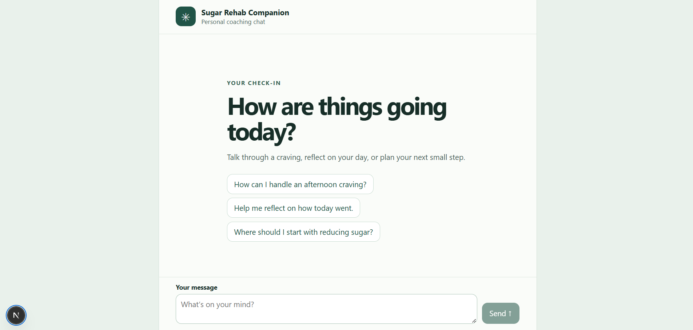

# Sugar Rehab Companion

Sugar Rehab Companion is a coaching chat for people working to change their sugar habits. Use it to talk through cravings, reflect on how the day went, or plan a manageable next step. The coach can answer questions about sugar habits and flag messages for human follow-up through email and push notifications.



## Run locally

You’ll need Node.js 22, Python 3, and an OpenAI API key. Generate a shared secret with Node.js.

```powershell
node -e "console.log(require('node:crypto').randomBytes(32).toString('hex'))"
```

Put `OPENAI_API_KEY` and the generated `COACH_API_TOKEN` in the repository root `.env`. In `frontend/.env.local`, set the same token and point Next.js at the local Python API.

```dotenv
COACH_API_URL=http://127.0.0.1:8000
COACH_API_TOKEN=paste-the-same-generated-token-here
```

From the repository root, start FastAPI in one PowerShell terminal.

```powershell
python -m pip install -r Sugar_Rehab_Companion/requirements.txt
python -m uvicorn app:app --app-dir Sugar_Rehab_Companion
```

Start Next.js in another terminal.

```powershell
cd frontend
npm.cmd install
npm.cmd run dev
```

Open [http://localhost:3000](http://localhost:3000) and send a message. See the [setup guide](setup.md#nextjs-chat) for more details.

## How it works

- The [Next.js frontend](frontend/app/page.tsx) shows starter prompts, a waiting state, and Markdown replies. If a request fails, the composer restores the message for a manual retry.
- The [Next.js chat route](frontend/app/api/chat/route.ts) forwards the latest message to the [FastAPI backend](Sugar_Rehab_Companion/app.py) using the server-side shared token.
- The [Python coach](Sugar_Rehab_Companion/sugar_rehab_companion.py) routes and moderates each message. For questions that need research, it also plans and attempts web searches before composing its reply. The API returns the completed reply as JSON. The current search implementation omits the planned query when calling the search agent, so replies may lack search results.
- When moderation escalates a message, the [notification agent](Sugar_Rehab_Companion/notification_agent.py) can attempt both Resend email and Pushover push once per moderation run. Configure `RESEND_API_KEY`, `PUSHOVER_API_TOKEN`, and `PUSHOVER_USER_KEY` using the [notification setup guide](setup.md#pushover-coach-notifications).

The current page holds the transcript in memory, and refreshing clears it. The coach receives only the latest message. User sign-in and saved conversations are future work.

## Deploy to Vercel

Create two projects from the same repository.

| Project | Root directory | Server environment variables |
| --- | --- | --- |
| FastAPI | `Sugar_Rehab_Companion` | `OPENAI_API_KEY`, `COACH_API_TOKEN`, and notification credentials |
| Next.js | `frontend` | `COACH_API_URL` set to the deployed FastAPI origin, and the matching `COACH_API_TOKEN` |

Restrict access to the frontend preview while sign-in is pending. The shared token authenticates calls from Next.js to FastAPI. Anyone who can access the frontend can send chat requests that use the configured API and may trigger coach alerts. [Vercel setup steps](setup.md#vercel-setup)
